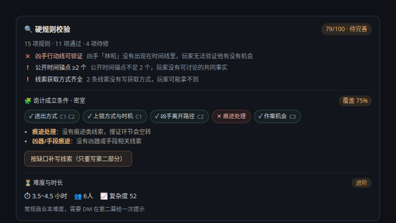
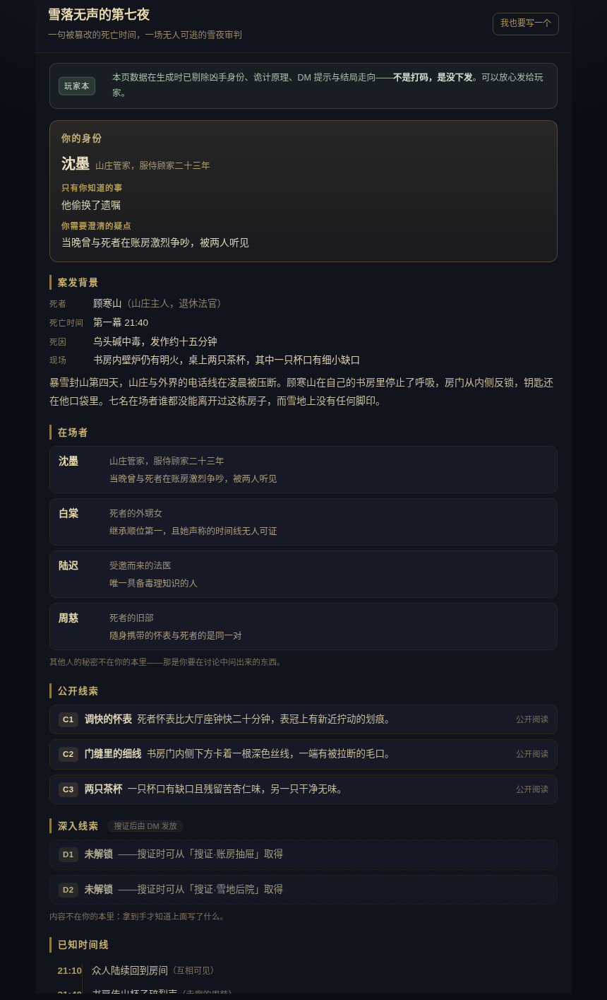
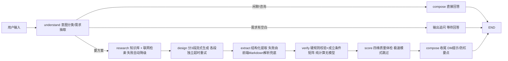

# 诡计设计师 · AI Agent 长文本生成工作台

<p align="center">
  
  
  
  
  
  
  
  
</p>

**一个面向长文本生成场景的 AI Agent 实战项目**：LangGraph 七节点编排、分段流式生成容错、双解析兜底、本地知识库检索、确定性公平性硬规则引擎（成立条件×线索覆盖矩阵）、四维质量评分、全链路运行指标、多模态生图、SSE 心跳与断点续跑。业务载体是剧本杀诡计方案设计，同样的架构可直接迁移到报告生成、课程设计、营销文案等任何长文档生成领域。

<p align="center">
  
  
</p>
<p align="center">
  
  
</p>
<p align="center">
  
  
</p>

> 一句话需求 → 一份结构完整、可直接使用的长文档方案，外加一整套配套工具链。

## 目录

- [项目解决了什么工程问题](#这个项目解决了什么工程问题)
- [功能一览](#功能一览)
- [技术栈](#技术栈)
- [架构](#架构)
- [关键设计详解](#关键设计详解)
- [使用示例](#使用示例)
- [项目结构](#项目结构)
- [快速开始](#快速开始)
- [接口约定](#接口约定)
- [异常与降级](#异常与降级)
- [测试与质量自检](#测试与质量自检)
- [Roadmap](#roadmap)
- [FAQ](#faq)
- [安全与内容边界](#安全与内容边界)

## 这个项目解决了什么工程问题

| 难题 | 方案 | 结果 |
| --- | --- | --- |
| 长文本生成超过平台函数时长上限，整单超时作废 | **分段流式生成**：方案拆 3 段独立超时/重试（115s/85s/全局 deadline） | 任一段失败只丢一段，已流出内容全部保留 |
| 轻量模型结构化提取不稳定（实测偶发空结果） | **双解析兜底**：后端结构化提取 + 前端从流式 Markdown 现场解析，两者合并 | 提取失败时沉浸模式/线索卡等下游功能依然可用 |
| 长任务被中间层判定空闲掐断连接 | **SSE 心跳**（每 20s）+ 前端识别「正文完整但收尾中断」降级为提示 | 断流不再误报错误，保留断点重试入口 |
| 380KB 的 docx 库拖慢首屏 | **代码分割 + 动态 import** | 首屏 JS 734KB → 370KB（gzip 225KB → 120KB）；九个弹层再按需加载，又省 42KB |
| 多轮对话需要跨实例恢复 | LangGraph Checkpointer 持久化状态机（thread_id = conversation_id） | 无自建数据库即可多轮记忆 + 断点续跑 |
| AI 说「方案很好」但玩家开本才发现推不出来 | **四维 rubric 质量体检**：线索公平性 / 锁凶闭环 / 时间线自洽 / 红鲱鱼质量各 0-10 打分 | 「能不能开本」从主观判断变成可量化的 40 分制指标 |
| 连续迭代后想回到之前的稿子，只能凭记忆重写 | **版本历史**：`aget_state_history` 列出快照，`aupdate_state(as_node=compose)` 写回旧稿，状态指向旧版且不触发节点重跑 | 改坏了一键回退，回退后继续迭代以旧稿为底 |
| 多人剧本最怕「换个画师/换个工具，角色就换了张脸」，而接图片 API 又要密钥与费用 | **立绘一致性双轨**：角色表新增「外形锚点」列（模型生成可落笔的具体特征），seed 由「标题+角色名」哈希——文字与数字都无随机量；前端用确定性 SVG 把 seed 画出来当场自检 | 同角色重开多少次都是同一张脸；「🎨 立绘提示词包」一键复制，贴进任何画图工具即可产出一致的正稿 |
| 结局只有一个标准答案，复盘照本宣科，玩家的不同推理走向没有归宿 | **多结局分支树**：方案生成「结局分支」表（结局/触发条件/支撑线索/走向），硬规则校验每条结局引用的线索编号真实存在（防「凭空结局」）；前端画成树状图，编号 chip 在线索表找不到会标红 | 开本复盘按玩家实际走向收尾；玩家本/分享链接依旧不下发任何结局信息 |
| 只给「回退」按钮，等于让用户盲选——不知道这一版和当前差在哪 | **版本对比**：新增只读入口 `version_content`（看一眼不该产生副作用），前端做行级 LCS diff + 章节级汇总，连续相同行折叠成「省略 N 行」 | 结论一句话说清「新增 12 行、删除 3 行、涉及 2 个章节」；超长方案自动退化为逐行比对，不卡主线程 |
| 公开部署后连点会烧模型额度 | **用户级滑动窗口限流**，限额内放行、超限返回友好提示；限流自身异常强制放行 | 成本可控，且限流故障不会挡住正常用户 |
| 生成内容同质化、套路重复 | **诡计查重 + 双路检索**：从会话 metadata 提取历史诡计指纹（trick_types + core_trick），生成前注入避开指令；关键词加权语料 + 联网检索双路供给 | 同一用户连续生成不会撞车；指纹零额外存储，list_conversations 顺路取回 |
| 模型自评的分数会漂移，且无法解释「为什么扣这一分」 | **公平性硬规则引擎**：16 条确定性规则加权 0-100（凶手在角色表内、证据链 ≥3 环、线索有获取方式、死亡时间对得上时间线…），另产出诡计成立条件 × 线索覆盖矩阵 | 判定可复现、可单测；缺哪条线索一目了然，且能一键把缺口回填进下一轮重写（检出 → 修复闭环） |
| 玩家本若靠前端隐藏 DOM，开发者工具一改样式就穿帮 | **遮罩在数据层**：`buildPlayerPacket` 白名单逐字段复制生成玩家可见子集（凶手/诡计原理/DM 提示在编码前就消失），再 deflate 压缩进 URL 分享 | 权限判断可单测断言「敏感字段绝不在输出 JSON 里」；链接即快照，零存储零鉴权 |
| TTS 遇到的三个现实问题：Markdown 念出「星号」、Chrome 对长 utterance 约 15 秒静默截断、中文语音对 C1 读法不统一 | 朗读前先做**口语化清洗**（标记/箭头/编号转中文说法，emoji 剔除），再**按标点切块**逐条串联朗读 | `speech.ts` 纯函数 + 20 个单测覆盖；切块串联天然绕过截断；语速/语音列表动态探测 |
| 主持台只能一次看一个阶段，线下开本时 DM 想要的是一张能摊在桌上的纸 | **DM 主持手册打印**：一键把全部阶段排成 A4 纸质手册——阶段一览表（含合计时长）、每阶段引导词、线索排成可打勾的方框、复盘念稿（凶手/动机/结局分支表）与签名栏 | 新窗口直出打印排版，浏览器里「另存为 PDF」即得；无线索阶段不出清单，无复盘内容不出复盘页 |
| 口头反馈记不住、跨设备不同步还可能泄露隐私 | **本地批注**：在正文里划选一段文字 → 浮出「加批注」→ 就地写一句；按「会话+消息+原文片段」锚定，清单面板可一键回跳原文、复制全部 | 只存本机 localStorage（不上传、不进分享链接）；同句重复加批注视为修改，隐私模式/配额满静默降级不碰主流程 |
| 单元测试全绿但「拼起来不一定能用」——SSE 解析、状态编排、条件渲染、权限裁剪、hash 路由任一处断链都测不出 | **Playwright 真浏览器 e2e**：后端起不来就用 route 按 action 回放真实 SSE 协议，跑完生成→体检卡→玩家本→分享链接→新标签页只读页；失败上传 trace | 4 条路径 3.3 秒跑完，进 CI 独立 job；能断言「敏感信息在 DOM 里根本不存在」这类单测测不到的不变式 |
| 出问题只能翻平台日志，答不上「线上怎么排查、一次多少钱」 | **全链路 trace + 运行指标**：每次请求记录 trace_id / 首字延迟 / 各阶段耗时 / 输出估算 token，进程内保留最近 200 条并聚合出 P50/P95/成功率/规则失败排行 | 前端 📊 面板直接看瓶颈在哪一步、失败长什么样 |
| 网络抖一下、中间层掐断连接，用户就得重写三分钟的需求 | **失败分层 + 有条件的自动重连**：异常先归类（abort / offline / timeout / network / server / client），只有「瞬时故障且一个字都还没吐出来」才自动重连（最多 2 次，全抖动退避）；已吐正文绝不自动续，避免两份内容拼在一起 | e2e 用 `route.abort()` 造连接失败，断言第二次请求救回整份方案、且不留错误横幅 |
| 任何一处渲染异常，用户看到的是一片白，连「发生了什么」都问不出来 | **顶层 ErrorBoundary + 可复制崩溃报告**：捕获子树异常后渲染说明页，报错文本里带上时间/组件栈/环境，并**隐去 URL 里的分享 token**（解出来就是整份玩家本） | 类组件兜住 hooks 兜不住的渲染期异常；崩溃页本身也有单测（17 条） |
| 需求写了一半误刷新，草稿全没了 | **输入草稿本地暂存**：8KB 上限、隐私模式/配额满静默降级、发送即清空 | 存储不可用的三条降级路径都有单测，坏掉也不会挡住主流程 |

## 功能一览

### 从一句话到完整方案

- **智能追问**：需求有空白时先问 2~3 个带选项的关键问题；说「直接生成」可跳过
- **需求构造器 / 灵感骰子** ：把需求拆成题材 / 人数 / 难度 / 诡计 / 氛围五个维度逐项选择，拼装成一句完整需求；「灵感骰子」一键从各维度候选池随机抽取组合，适合头脑风暴与快速探索
- **多方案对比**：一次给出 A/B/C 三个创意方向，选定后展开完整方案
- **迭代修改**：基于上一版增量调整（换诡计、增删角色、修漏洞），不被旧稿锚定；也支持「补写第 N 部分」恢复降级章节
- **单段重写**：说「重写第二部分」只重跑那一段，其余章节原样保留，不必整篇等 3 分钟

### 质量保障

- **质量体检评分卡**：方案生成后自动按四维 rubric 打分（每维 0-10 分），给出具体到「加一条什么线索」的改进建议；综合 ≥32 且单项 ≥6 判定「可开本」
- **硬规则校验卡**：与模型自评并列的**确定性**校验——15 条规则加权得分 + 逐条原因（如「凶手不在角色表内，玩家选不到他」），全部通过时才给「可开本」
- **诡计成立条件矩阵**：把核心诡计拆成「进出方式 / 上锁时机 / 痕迹处理…」等成立条件，逐条核对手法是否只写在 DM 手册里而没有玩家可见线索承载（**DM 独占信息 = 不公平**）；缺口可一键回填重写
- **难度与时长预估**：按嫌疑人数 / 线索量 / 手法层数 / 类型负担推算难度档位与开本时长区间，分数构成完全透明
- **公平性自查**：线索对所有玩家可得，拒绝「只有上帝视角才能破案」的诡计；锁凶证据链要求 2 条独立公开线索 + 1 条深入线索
- **知识库注入**：9 篇原创诡计方法论（密室破法 / 不在场证明构造 / 叙诡公平边界 / 红鲱鱼设计 / 玩家雷点 20 条等）按需求关键词加权检索注入生成上下文

### 开本工具链

<p align="center">
  
  
</p>

- **DM 主持台**：开本各阶段标签（开场 / 搜证 / 讨论 / 指凶）、计时器、开场引导词；**引导词与复盘真相可一键朗读**（浏览器内置语音，零依赖零 API key，语速可调，切阶段自动停止）；**一键打印主持手册**：全部阶段 + 可打勾的线索清单 + 复盘念稿排成 A4 纸质手册
- **证据链时间线**：时间线解析为可交互时间轴，点击事件自动匹配「谁作证、哪条线索能戳穿它」
- **角色速览卡**：每个角色的公开身份 / 隐藏身份 / 秘密动机一页速查
- **救场手册**：玩家卡壳时的分级提示话术（轻提示 → 中提示 → 直接揭秘）

### 玩家侧交付（双视角）

<p align="center">
  
</p>

- **玩家本（无剧透视角）**：同一份方案按玩家权限重新裁剪——通用本不含任何人的秘密；选某个角色则多出「只有你知道的事 / 你需要澄清的疑点」。深入线索只显示编号与获取方式，互动选项**不显示结局类型**（死亡/安全标签属于剧透）
- **遮罩在数据层而不是 CSS 层**：凶手、诡计原理、DM 提示、红鲱鱼排除方式、隐藏结局在编码前就从对象里消失（白名单逐字段复制，绝不 spread 原对象）。扒 DOM、改样式都还原不出没权限看的内容
- **分享链接**：玩家本 deflate 压缩 + base64url 编码进 `#/s/<token>`，链接即快照——零存储、零鉴权、零后端改动；解析失败一律降级为「链接无效」页而不是抛错

### 多模态与导出

<p align="center">
  
</p>

- **AI 封面**：人物海报 / 群像 / 场景三种风格；人脸用 wan2.5-t2i-preview（稳定性优先），场景用 wanx2.1-t2i-turbo（速度优先），按用途分流
- **沉浸互动剧情**：第二人称冒险，限时抉择 + 死亡/存疑/安全结局 + Web Audio 心跳/死亡音效（零音频文件，实时合成）；每个分镜可「朗读本页」，旁白念的是结构化方案而非 DOM 文本
- **案件重演**：证据链时间线一键「▶ 重演案件」——按时间轴逐帧回放、关联线索随帧联动、终幕落在凶手真相；播放/暂停/步进/进度点跳帧
- **全局快捷键**：`/` 聚焦输入、`g d/t/p` 序列开 DM 台/时间线/玩家本、`?` 速查卡；输入态一律让位给打字
- **数据备份**：书架 + 批注 + 草稿一键导出 JSON、导入恢复（按 id 合并、时间戳新者胜，不用旧稿盖新稿）
- **移动端开本**：≤640px 弹层全宽、触控目标 ≥44px、表格横滚、输入框 16px 防 iOS 聚焦缩放
- **多格式导出**：完整版/玩家版 Word、扑克式线索卡、Markdown、PNG/AI 封面，以及**打印 / 另存为 PDF**（A4 排版，一键打印成册）
- **版本历史**：checkpointer 的历史快照直接变成可视化版本列表，一键回退到任意一稿并继续迭代（零额外存储）
- **版本对比**：任选一版与当前正文对比，按章节汇总改动量 + 逐行增删标色，看完再决定要不要回退
- **成本防护**：按用户滑动窗口限流（生成 10 次/10 分钟、生图 5 次/10 分钟），限流组件故障自动放行
- **本地书架**：生成完成的方案自动存入 localStorage 书架，多剧本并行管理；支持按标题/正文搜索（命中处给上下文片段）与三种排序
- **会话列表**：按今天/昨天/最近七天/更早分组，四条以上自动出现搜索框；删除会话要点两次（连历史带状态一起没，不可逆）
- **多结局分支树**：1 条真结局 + 走向分支，树状展示「哪条线索通向哪条结局」；幽灵编号（线索表里不存在的）实时标红；DM 复盘朗读会把每条分支念出来
- **角色立绘一致性**：角色卡内置确定性 SVG 肖像（同 seed 必同图），外形锚点文字反向驱动发色/发型/衣色；支持逐人复制提示词或复制整包

## 技术栈

| 层 | 技术 |
| --- | --- |
| 前端 | React 18 + TypeScript + Vite（手写 CSS，无 UI 框架） |
| 后端 | Python 3.11 + LangGraph（七节点状态机编排）+ LangChain（模型调用 / bind_tools 结构化输出） |
| 对话模型 | 阿里云 DashScope / 通义千问（qwen-plus 主力、qwen-flash 轻量） |
| 生图模型 | 通义万相 **wan2.5-t2i-preview**（人物/群像，人脸稳定）与 **wanx2.1-t2i-turbo**（场景，速度优先），按用途分流；异步任务 + 轮询取图 |
| 检索 | 平台内置 web_search + 本地知识库（kb.py 关键词加权） + 高德地图 API（真实天气注入环境细节） |
| 流式传输 | SSE（fetch + ReadableStream 手写解析，支持 POST 与自定义头） |
| 存储 | EdgeOne Makers KV/Blob（LangGraph Checkpointer）+ localStorage |
| 图形与音效 | Canvas/SVG 封面合成；Web Audio 实时合成音效（零音频文件） |

## 架构



| 节点 | 职责 | 容错 |
| --- | --- | --- |
| `understand` | 意图分类（new / iterate / question）+ 需求字段抽取（BriefPatch schema）+ 追问判断 + 对比模式识别 | LLM 意图判断 + **正则兜底**（寒暄整句匹配 / 问句特征 / 「直接生成」短语），模型抖动时体验一致 |
| `research` | 本地知识库关键词加权检索（tags 精确匹配 + 别名归一化，如「暴风雪山庄」→「封闭场景」）+ 联网检索 | 单条 25s 超时，失败仅提示不阻断 |
| `design` | 3 段独立流式生成（核心诡计 / 凶手线索 / 时间线沉浸剧情），三段共享同一份大纲与系统提示词 | 单段超时独立重试（重试自动加「务必精简」），仍失败则占位降级，绝不让整单作废 |
| `extract` | bind_tools 强制 function call，Pydantic 严格校验，从方案提取结构化 JSON | 超时重试 + JSON 解析兜底；失败时前端 parsePlan 从 Markdown 抢救 |
| `verify` | **纯计算节点**：16 条公平性硬规则（fairness.py）+ 诡计成立条件×线索覆盖矩阵（trick_graph.py）+ 难度时长预估（difficulty.py），结果经 meta.rules 送达前端 | 零模型调用、可单测；结构化缺失时从 Markdown 兜底解析（mdplan.py）；任何异常静默跳过 |
| `score` | 四维 rubric 打分（线索公平性 / 锁凶闭环 / 时间线自洽 / 红鲱鱼质量），结果经 meta 事件送达前端评分卡 | 极速模式跳过；评分失败静默降级，不影响交付 |
| `compose` | 收尾：标题确定、meta 汇总、咨询问答（qa 模式） | 正文已在 design 实时流式展示，此处只做收尾 |

多轮记忆：`context.store.langgraph_checkpointer` 以 conversation_id 持久化全部状态（messages 全量 + brief/design/quality 等字段），跨实例可恢复；喂给模型的上下文按最近 6~8 条裁剪，**存档与上下文窗口分离**——存的是全量，喂的是最近几句。

## 关键设计详解

### 分段流式生成的容错逻辑

```
段1（核心诡计，预算 115s）
  ├─ 开始前检查全局 deadline（195s），剩余 <20s 直接放弃本段
  ├─ 超时 → 已流出的字保留在页面上 → 重试（提示词追加「务必精简」）
  └─ 两次失败 → 占位符「## 待补充：…」+ notice 提示「回复补写 N 即可」
段2 / 段3 同理，互相独立，一段失败不影响其余
```

设计要点：

1. **失败是常态**：每层都有预案，而不是祈祷不超时
2. **降级而不是崩溃**：宁可交付 90% 的方案 + 占位符，也不交付一个报错
3. **已付出的成本不浪费**：流式输出让「失败的那一半」依然呈现在用户眼前
4. **可恢复**：占位符带「补写 N」指令，用户回复后走 iterate 管线，旧方案全文作为底稿注入，模型只补缺失章节——此时是新一轮独立请求，没有 deadline 压力

### 三段为什么不会「割裂」

- **共享大纲**：三段拿到同一份 base_payload（understand + research 的产出），设定级信息（诡计、凶手）天然一致
- **共享文风规范**：同一个 SystemMessage（11 条硬性质量标准），语气详略统一
- **章节边界切分**：每段的起止都卡在完整的章节标题上，拼接痕迹被正常的章节切换掩盖
- **表格化文体**：方案主体是速览表 / 线索表 / 时间线表，对文风不敏感；叙事最重的背景故事完整待在段 1 内

### 双解析兜底

```
正常路径：design 实时流式输出 Markdown → extract 发起 function call → 规整 JSON → 工具视图
兜底路径：function call 失败 → 后端把完整 Markdown 经 SSE meta 推给前端
         → 前端 parsePlan.ts 用「表格行/章节/子章节」原语 + pick() 多候选键名
           （对抗模型表头不确定性）从 Markdown 还原结构化数据 → 工具视图依然可用
```

### SSE 协议

| 事件 | 载荷 | 前端行为 |
| --- | --- | --- |
| `status` | stage + label | 点亮阶段进度条 |
| `token` | delta | 聊天气泡打字机追加 |
| `notice` | message | 黄色提示条（降级说明 / 评分结果） |
| `meta` | title / genre / lock_score / quality / plan / **rules** | 存结构化数据，供评分卡、硬规则卡与工具视图 |
| `done` | traceId / durationMs / firstTokenMs / stages | 解锁输入框；展示「本次耗时 / 首字延迟」 |
| `error` | message | 显示错误 + 允许 retry |

实现细节：因聊天需要 POST 与自定义头，未用 EventSource，而是 fetch + ReadableStream 手写解析——按 `\n\n` 分帧、`\r\n` 归一、残帧缓存拼接、心跳帧丢弃。

### 生图链路

```
前端选风格（character/group/scene）
→ 后端读会话存储里的结构化 brief（题材/时代/标题）填入三套构图模板
  （模板 = 构图主体 + 光影 + 胶片质感 + 标题留白 + 负面提示词）
→ 按用途选模型：有人脸 → wan2.5（稳定）；纯场景 → wanx2.1-turbo（快）
→ DashScope 异步任务：提交 → task_id → 3s 轮询（上限 90s）→ 下载转 base64
```

## 使用示例

```
你：暴雪山庄背景的密室本，5 人，新手难度

AI：（追问）出发前确认 2 件事：
    1. 核心诡计偏好？ A.物理密室 B.心理盲区 C.时间错位
    2. 要不要红鲱鱼误导线？

你：C，要两个红鲱鱼

AI：🔍 正在检索经典诡计与玩家雷点…
    📝 正在搭建核心诡计（1/3）…（文字打字机流出）
    （约 3 分钟后输出完整方案 + 质量体检 33/40 · 可开本）

你：把凶手换成医生，加一条录音机线索
AI：（iterate 意图）基于上一版增量重写，其余章节保持不变
```

## 项目结构

```
.
├── agents/                      # Makers 会话模式 Runtime（文件/目录即路由）
│   ├── _lib/
│   │   ├── app.py               # HTTP 入口：action 路由、SSE、会话 CRUD、导出、AI 封面
│   │   ├── graph.py             # LangGraph 工作流装配（条件边 + checkpointer 注入）
│   │   ├── nodes.py             # understand / research / design / extract / verify / score / compose
│   │   ├── schemas.py           # 结构化输出的 Pydantic Schema（BriefPatch / PlanDigest / QualityScore）
│   │   ├── prompts.py           # 各节点 SystemMessage + 11 条硬性质量标准
│   │   ├── kb.py                # 本地知识库检索（关键词加权 + 别名归一化）
│   │   ├── knowledge/           # 24 篇诡计方法论语料（通用方法论 11 + 分题材/专精 13）
│   │   ├── dedup.py             # 诡计查重：历史指纹收集 + 避开指令生成（纯函数）
│   │   ├── fairness.py          # 公平性硬规则引擎：16 条确定性规则加权打分（纯函数）
│   │   ├── trick_graph.py       # 诡计成立条件 × 线索覆盖矩阵（纯函数）
│   │   ├── difficulty.py        # 难度档位与时长预估（纯函数）
│   │   ├── mdplan.py            # Markdown → 结构化方案（extract 失败时的兜底数据源）
│   │   ├── telemetry.py         # 运行指标：trace 记录 / P50-P95 聚合 / 规则失败排行（进程内）
│   │   ├── search.py / amap.py  # 联网检索与天气（失败静默降级）
│   │   └── state.py / config.py / models.py / logger.py
│   ├── trick-designer/index.py  # POST /trick-designer
│   └── stop/index.py            # POST /stop
├── src/
│   ├── components/              # 18 个组件：聊天、沉浸模式、玩家本（无剧透视角）、
│   │                            #   DM 主持台、时间线、角色卡、救场手册、质量评分卡、
│   │                            #   硬规则校验卡、运行指标、需求构造器、导出栏等
│   ├── lib/api.ts               # SSE 解析（consumeStream/handleEvent）、会话 CRUD
│   ├── lib/parsePlan.ts         # Markdown → 结构化方案（前端兜底解析）
│   ├── lib/docxExporters.ts     # Word 导出（按需动态加载，首屏不加载 docx 库）
│   ├── lib/shelf.ts / sound.ts  # 本地书架 / Web Audio 音效
│   ├── lib/sessionFilter.ts     # 会话列表搜索与时间分组
│   ├── lib/illustration.ts      # 角色立绘一致性：seed 哈希 + 确定性 SVG + 提示词包
│   ├── lib/printDM.ts           # DM 主持手册打印：全阶段一览 + 打勾线索清单（纯函数）
│   ├── lib/annotations.ts       # 本地批注：会话+消息+原文片段锚定（localStorage）
│   ├── lib/share.ts / speech.ts # 玩家本裁剪与分享编码 / 朗读文本清洗与切块
│   ├── hooks/useSpeech.ts       # 浏览器语音朗读封装（重入叠音、卸载清理）
│   └── App.tsx                  # 全局状态编排（含 #/s/* 分享路由分流）
├── e2e/                         # Playwright 端到端（真浏览器 + route 回放后端协议）
├── docs/screenshots/            # README 展示图
├── edgeone.json                 # Makers 项目配置
└── package.json
```

## 快速开始

```bash
# 1. 安装依赖
npm install
python -m venv .venv && source .venv/bin/activate
pip install -r agents/requirements.txt

# 2. 关联 EdgeOne Makers 项目（同步模型 API Key 等环境变量）
npm i -g edgeone
edgeone makers link

# 3. 本地开发
edgeone makers dev       # http://localhost:8088
```

环境变量（由 `edgeone makers link` 同步）：

| 变量 | 说明 |
| --- | --- |
| 模型 API Key / Base URL | DashScope（qwen + 万相共用） |
| `AMAP_KEY`（可选） | 高德地图，用于真实天气注入 |

## 接口约定

所有 `agents/*` 请求须携带请求头 `Makers-Conversation-Id`（6–36 字符）。

| 路由 | 请求体 | 响应 |
| --- | --- | --- |
| `POST /trick-designer` | `{ "action": "chat", "message": "..." }` | SSE：`session / status / notice / meta / token / done / error` |
| `POST /trick-designer` | `{ "action": "retry" }` | 从 checkpoint 断点续跑 |
| `POST /trick-designer` | `{ "action": "sessions" }` / `"history"` / `"delete"` | 会话管理 |
| `POST /trick-designer` | `{ "action": "export" }` | 导出用完整方案（markdown + brief + plan + lock_score） |
| `POST /trick-designer` | `{ "action": "ai_cover", "cover_style": "character" }` | Base64 封面图（`character` / `group` / `scene`） |
| `POST /trick-designer` | `{ "action": "stats" }` | 运行指标聚合（P50/P95/成功率/阶段耗时/规则失败排行，只含哈希与耗时，不含用户原文） |
| `POST /stop` | `{ "conversationId": "..." }` | 中止当前运行 |

## 异常与降级

- **联网检索失败/超时**：单条 25s 超时，失败仅提示，不阻断生成
- **知识库为空/未命中**：`retrieve_knowledge()` 返回空列表，流程自动降级为「仅依赖模型与联网检索」
- **结构化提取失败**：前端用 Markdown 解析兜底，功能不中断
- **质量体检失败/极速模式**：评分静默跳过，不推评分卡，方案正文不受影响
- **硬规则校验失败**：verify 节点吞掉异常返回空 rules，前端不上卡片；校验挂在 extract 之后，不占用任何模型调用
- **朗读不可用**：环境不支持 Web Speech API 时朗读按钮整个隐藏（而非可点无响应）；语速、中文语音按平台实际可用列表动态挑选
- **某一段设计超时**：保留已生成内容，标注「待补充」，可让模型补写
- **模型超时/限流/鉴权失败**：统一转中文友好提示，经 SSE `error` 推送
- **收尾断流**：正文完整时降级为提示，保留断点重试入口
- **客户端断开**：监听 `signal` 中止图执行，避免无效 token 消耗

## 测试与质量自检

### 自动化测试

```bash
pnpm test                        # 前端单元测试（vitest，324 个用例）
pnpm test:e2e                    # 浏览器端到端（Playwright，18 条路径打穿全链路）
.venv/bin/python -m pytest tests/ -q   # 后端单元测试（pytest，202 个用例）
pnpm typecheck                   # 全量类型检查
pnpm build                       # 生产构建
```

CI（`.github/workflows/ci.yml`）在每次 push / PR 自动跑：前端类型检查 + 单元测试 + 构建，后端语法检查 + 单元测试。

覆盖重点放在**容错的纯函数**上——输入输出明确、无外部依赖，一旦坏了用户直接看到错误数据：

| 被测对象 | 用例数 | 为什么值得测 |
| --- | --- | --- |
| `parsePlan.ts` 兜底解析 | 12 | 结构化提取失败时，全靠它从 Markdown 抢救数据；表头措辞变化、缺章节、空输入都要稳 |
| 意图兜底正则（寒暄 / 短问句 / 跳过追问） | 约 30 | 模型抖动时的最后一道防线，误判会让「你好」触发一次 3 分钟的生成 |
| 单段重写识别与拼接 | 约 20 | 拼接算法错了会直接丢用户的已有章节 |
| 打印排版 Markdown 渲染 | 7 | 含 HTML 转义断言，防止方案内容注入 |
| `fairness.py` 公平性硬规则 | 31 | 判定错了会把好方案判死、或放过硬伤；每条规则单独断言通过 / 失败 / 部分分三档 |
| `trick_graph.py` 成立条件矩阵 | 13 | 误报会让用户无谓重写，漏报会让「DM 独占信息」漏网；重点测「手法写了但线索没写」的提示 |
| `difficulty.py` 难度时长 | 10 | 系数改错会输出荒谬的时长；验证单调性、区间合法性、空数据不崩 |
| `mdplan.py` Markdown 解析 | 19 | extract 失败时它是唯一的数据来源，章节残缺也不能抛异常；结局分支表新旧表头都能解析，没有该章节时不产出字段 |
| `illustration.ts` 立绘一致性 | 36 | 一致性的根在哈希：seed 恒定/顺序无关/跨本不撞脸；锚点文字反向驱动发色发长衣色、抽象词不干扰；SVG 纯函数无随机量；渲染默认不泄露秘密 |
| `printDM.ts` DM 手册打印 | 15 | 纸上手一抖就是白纸：阶段一览表合计时长、勾选框与编号、复盘块按有无内容整体出/不出、用户内容 HTML 转义；打印窗口被拦截给可操作提示、打印挂在 load 之后防空白页 |
| `annotations.ts` 本地批注 | 9 | 锚点与去重策略：同句重复加批注=修改、总量上限丢最旧、片段/批注截断、存储抛错（隐私模式/配额满）静默降级、导出文本带出处 |
| `markdown.tsx` 块级渲染 | 11 | 围栏代码块内的空行是内容不是分界（切坏代码块是最危险回归）；块渲染与整篇渲染等价、CRLF/空输入/未闭合围栏不崩 |
| `replay.ts` 案件重演帧编排 | 7 | 深入事件带「玩家当时没看到」标记、真相帧只在解析出凶手时收尾、空时间线也能放真相、字段缺失容错 |
| `backup.ts` 数据备份 | 13 | 往返一致（导出→清空→恢复回来）、新者胜不覆盖本机新稿、草稿不覆盖正在写的内容、非法条目过滤、重复恢复幂等 |
| `shortcuts.ts` 快捷键决策 | 12 | 输入框/组合键让位给打字、裸按 d/t/p 不误触、g 序列窗口合理、键位表与动作同源 |
| `annotationsUi` 批注 UI | 8 | 消息批注条渲染与 data-mid 锚点、浮标两态、清单空态/列表/页脚说明；删除按钮 aria-label |
| `EndingTree` 结局分支树 | 11 | 编号提取（去重/大小写/不误判中文）、真结局徽章只给第一条、幽灵编号标红、空态给引导而非空白 | extract 失败时它是唯一的数据来源，章节残缺也不能抛异常 |
| `verify` 节点行为 | 11 | 挂在主链路上：跳过条件、正文兜底、异常吞咽都必须严格，否则会拖垮交付 |
| `share.ts` 玩家本裁剪 + 编码 | 18 | 权限不变式：凶手/秘密/深入线索内容/结局类型断言**绝不出现在输出里**；编码往返、截断容错、hash 解析 |
| `PlayerView` 渲染不变式 | 8 | 用 renderToStaticMarkup 断言敏感内容不进 DOM（含 XSS 转义），分享页模式无关闭入口 |
| `speech.ts` 朗读文本处理 | 20 | Markdown 标记 / 箭头 / 编号 / emoji 的口语化清洗；按标点切块规避 Chrome 15 秒截断；中文语音挑选策略 |
| `narration.ts` 分镜旁白 | 10 | 按 stage 从结构化方案重组念稿（而非爬 DOM）：跳过深入线索/时间线、搜证只报数量、空方案每页都有兜底话术 |
| `net.ts` 失败归类与超时 | 23 | 重试决策全靠它：把 401 也当可重试会让用户白等，把断网当不可重试会让人以为程序坏了；另测看门狗重置、退避抖动、取消不被误判为超时 |
| `streamPolicy.ts` 重连策略 | 12 | 「什么时候能自动重连」是产品判断：已吐正文、已收 done、用户主动停止都必须拒绝，否则会把两段内容接在一起 |
| `sessionFilter.ts` 会话列表 | 13 | 分组边界（刚好七天、缺时间戳算今天、非法时间戳降级为更早）、时区无关、不修改入参 |
| `shelf.ts` 书架检索 | 16 | 搜索同时匹配标题与正文（用户记得情节不记得标题）、不修改入参数组、中文标题排序、片段截取的三处边界 |
| `diff.ts` 版本对比 | 19 | 行级 LCS 的还原性（去掉新增行必须等于旧版）、章节归属、删除整章的归属、折叠上下文的边界；另测超长文本退化路径不会卡死 |
| `draft.ts` 草稿暂存 | 12 | 存储抛错（隐私模式、配额满）必须静默降级——保命功能不能变成新的崩溃点 |
| `CrashScreen` 崩溃页 | 17 | 断言三条出路都在、默认不吓人地展开堆栈、**分享 token 被隐去** |
| e2e（Playwright + 真 Chromium） | 18 | 打穿「输入 → SSE 流式渲染 → 两张体检卡 → 玩家本 → 分享链接 → 新标签页只读页」；后端用 route 回放真实协议，断言敏感信息**在 DOM 里根本不存在**；另用 `route.abort()` 造断连验证自动重连整链路；Esc 关闭弹层按 dialog 语义定位；版本对比走完「打开列表 → 看差异 → 返回」；书架搜索命中正文并给出片段；用 `emulateMedia('print')` 断言打印版式确实变白底且不截断；会话列表走「搜索过滤 → 空态 → 删除二次确认」；结局分支树断言真结局徽章与幽灵编号标红；立绘断言两人 seed/SVG 互不相同且重开弹层后完全一致；DM 手册接管 `window.open` 断言纸上全阶段都在且线索带勾选框；本地批注走完「划选 → 浮标 → 保存 → 清单回跳高亮 → 删除回空态」；备份走完「下载→清空→从文件恢复→内容一致」；快捷键验证聚焦落字与输入态让位；390px 视口断言弹层全宽、触控目标、输入框 16px |
| `telemetry.py` 运行指标 | 20 | P95/成功率算错会误导优化方向；验证分位数、阶段聚合、容量淘汰 |
| trace 集成（handler 全链路） | 9 | 用假模型跑完真实 SSE 序列，验证 trace 真被记录、心跳不算阶段、错误被聚合 |

写测试过程中发现并修复的真实缺陷：

- **凶手信息提取失效**：`mdSubsection(md, '凶手')` 只查三级标题，而实际章节是二级的「## 四、凶手与人物逻辑」，导致工具视图拿不到凶手名。修复为「subsection → 二级章节 → 全文」三级回退
- **线索名称错列**：`pick(['线索'])` 会先命中最左的「线索内容」列，使 name 取到内容。修复为「先精确相等、再模糊包含」两轮匹配
- **「改一下凶手」误判为重写第一段**：正则把量词「一下」当成了序号「一」，用负向断言 `(?![下些点步])` 排除

### 已修复的真实问题（调试案例）

- **React error #310 整页白屏**：ExportBar 的条件 early return 位于 useState 与 useEffect 之间，hasPlan 变化时 hooks 数量不一致导致崩溃。通过非压缩构建定位，修复为 early return 移至全部 hooks 之后
- **mock 流式不结束**：SSE 响应缺 `Connection: close`，HTTP/1.1 keep-alive 导致前端流永真
- **时间线弹窗解析失败**：方案缺「六、时间线」表格章节，前端解析返回空——正是双解析兜底要处理的场景
- **懒加载漏了 Suspense 边界**：九个弹层改 `React.lazy` 后，`{showDM && <DMView/>}` 的写法在主界面正常（外层有边界），但分享页 `return <PlayerView/>` 是独立的渲染根，缺边界会让整页报错。补上后才安全——这类"只在某一条渲染路径上才暴露"的问题，单测和类型检查都发现不了，只能靠通读所有渲染出口
- **移动端顶栏五个按钮挤爆**：390px 下「沉浸模式/工具/📊/📚/状态胶囊」互相挤压，文字被竖排截断。修复：小屏隐藏顶栏沉浸模式按钮（底部悬浮 FAB 重复提供同一功能）、隐藏装饰性 eyebrow、状态胶囊改为单行省略。用 Playwright 对 1440/390 两个视口断言 `scrollWidth === innerWidth` 验证
- **时区把「昨天」整组吃掉了**：分组用例里会话时间写 `2026-03-09T20:00:00Z`，而沙箱时区是 UTC+8 —— 本地时间是 3 月 10 日凌晨 4 点，于是这条本该属于「昨天」的会话被判成「今天」，测试报「缺一个分组」。日期断言一律用**不带时区的本地时间**，别让 CI 机器的 `TZ` 决定测试结果
- **打印样式自己把自己刷白了**：`@media print` 里先给 `.pv-sheet` 设白底，随后又写 `.pv-sheet, .pv-sheet * { background: transparent }` 想清掉子元素底色——同一选择器后写的规则胜出，白底被自己的规则覆盖，打印出来是透明背景。改成只对子元素（`:not(.pv-sheet)`）生效，并用 `emulateMedia('print')` 在 e2e 里读计算样式断言
- **自动重连不能用「重试」一刀切**：最初想统一 `action: retry` 续跑，但连接阶段失败时后端根本没收到请求，没有断点可续，只会拿到"当前没有可恢复的断点"。改成按失败阶段分流：连接失败原样重发、流中断才续跑

## Roadmap

- [x] 单元测试：parsePlan、意图正则、单段拼接、打印渲染 + CI
- [x] 单段重写：只重写指定部分，其余章节原样保留（不必整篇重生成）
- [x] 打印 / PDF 导出：A4 排版 + 浏览器打印，另存为 PDF
- [x] 公平性规则引擎：16 条确定性硬校验（含分支结局线索支撑校验） + 成立条件×线索覆盖矩阵 + 一键回填缺口（verify 节点，零模型调用）
- [x] 诡计查重：历史方案指纹比对（metadata 零额外存储），命中注入避开指令，用户点名同类型时要求差异化
- [x] 角色立绘一致性：外形锚点 + 固定 seed 双轨确定性（seed 由「标题+角色名」哈希，同角色恒同脸），内置确定性 SVG 肖像可视化 seed，一键复制提示词包给任意画图工具
- [x] 运行指标：全链路 trace / P95 / 阶段耗时 / 规则失败排行（📊 面板）
- [x] 玩家侧视图：数据层权限化渲染（字段级白名单，凶手/诡计/DM 提示不下发）+ 角色专属本
- [x] 分享链接：玩家本压缩编码进 URL，链接即快照（零存储/零鉴权）；批注协作暂缓
- [x] TTS 朗读 DM 提示：浏览器内置语音（零依赖零 API key），文本口语化清洗 + 按标点切块规避 Chrome 长文本截断
- [x] 沉浸模式旁白朗读：按分镜从结构化方案重组念稿，翻页自动停止
- [x] Playwright e2e：真浏览器跑通生成 → 体检 → 玩家本 → 分享全链路（CI 独立 job，失败传 trace）
- [x] 断流自动重连：失败归类 + 阶段感知（连接失败重发 / 流中断续跑）+ 全抖动退避，e2e 有断连用例
- [x] 白屏兜底：顶层 ErrorBoundary + 可复制崩溃报告（URL 里的分享 token 自动隐去）
- [x] 草稿保护：输入内容本地暂存，误刷新不丢；存储不可用时静默降级
- [x] 弹层按需加载：九个面板改 `React.lazy`，首屏包再降 42KB（gzip 15KB）
- [x] 键盘可达：九个面板补 `role="dialog"` + `aria-modal`，Esc 统一关闭，跳转载入与可见焦点环
- [x] 版本对比：只读的 `version_content` 接口 + 行级 diff + 章节级改动汇总（超长文本自动退化）
- [x] 案卷检索：书架按标题/正文搜索 + 三种排序，命中处给上下文片段
- [x] 玩家本打印：白底黑字分页版式（展开滚动容器、隐藏操作栏），线下开本直接打给玩家
- [x] 会话列表：时间分组 + 标题搜索；删除会话改为两段式确认（误删不可逆）
- [x] 多结局分支树：结局分支表 + 支撑线索编号硬校验 + 树状可视化（玩家本依旧不下发）
- [x] 键盘闭环：Esc 有弹层时关弹层、无弹层时停止生成；输入框提示随状态切换

## FAQ

**Q: 为什么不用 EventSource？**
A: EventSource 只支持 GET 且不能带自定义头，而聊天需要 POST + 会话 ID 头，所以用 fetch + ReadableStream 手写解析。

**Q: 为什么 3 分钟就出结果？会不会牺牲质量？**
A: 平台函数 300 秒硬上限是约束条件，不是目标。分段 + deadline 的设计保证「一定在时限内交付」，质量由知识库注入、11 条硬性质量标准和四维评分兜底。

**Q: checkpointer 存了什么？**
A: 存对话消息与方案状态（按 conversation_id），用于多轮记忆和断点续跑；密钥等敏感信息在平台环境变量中，不进代码仓库。

**Q: 知识库是 RAG 吗？**
A: 是轻量版（RAG-lite）：关键词加权匹配 + tags 别名归一化，不依赖向量库。好处是零外部依赖、检索结果可解释；代价是语义泛化弱于向量检索——语料过百篇后可平滑升级，检索接口不变。

Q: 防同质化靠知识库吗？

A: 不是。知识库负责「写得专业」，防「写得重复」靠诡计查重：历史方案的 trick_types 与核心手法名作为指纹，与当前需求比对，命中则向提示词注入避开与差异化指令。两套机制各管一头。

**Q: 硬规则校验和质量体检评分有什么区别？**
A: 质量体检是模型按 rubric 给的「软分」，评的是好不好玩、详略是否得当；硬规则是纯代码算的「硬分」，验的是结构上成不成立（凶手在不在角色表、线索有没有获取方式、死亡时间对不对得上时间线）。前者会漂移，后者可复现——两张卡并列展示，互相印证。

**Q: 关键词匹配的成立条件矩阵会误判吗？**
A: 会，这是刻意取舍。规则只统计「玩家可见材料里有没有相关物证」，宁可漏报也不误伤：匹配不到时还会区分「手法里写了但线索没写」（提示补线索）与「完全没提」（提示补设定）。如果一条线索措辞完全避开了关键词，它会被漏掉——这类漏检由模型自评的质量体检兜底，两套机制互补。

**Q: 分享链接为什么不用后端短链？**
A: 会话数据存在带 user_id 鉴权的 Blob 存储里，匿名访问天然不成立；为了分享去开一个无鉴权读接口属于纯增攻击面。方案本身是静态可读数据，deflate + base64url 压进 URL 换来「零存储、零鉴权、链接即快照」，代价是链接较长（实测压缩后 1~2KB）且不会随后续修改更新——对「发朋友开一局」这个场景是正确取舍。另外 SPA 无法按链接动态生成 OG 标签，IM 预览只会显示站点信息，这是已知限制。

## 安全与内容边界

- 仅用于虚构剧本杀创作，不生成真实暴力细节，不设计可现实复刻的手法（核心诡计必须附「现实不可复刻说明」）
- 线索对所有玩家可得，拒绝「只有上帝视角才能破案」的诡计
- `agents/_lib/knowledge/` 下的诡计方法论语料为作者原创整理，只收录手法、结构、思路层面的方法论，不收录任何受版权保护的剧本原文

## 免责声明

本项目仅用于剧本杀虚构内容创作与娱乐，不构成任何现实行为指导。
