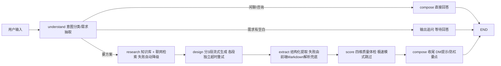

# 诡计设计师 · AI Agent 长文本生成工作台

**一个面向长文本生成场景的 AI Agent 实战项目**：LangGraph 六节点编排、分段流式生成容错、双解析兜底、本地知识库检索、四维质量评分、多模态生图、SSE 心跳与断点续跑。业务载体是剧本杀诡计方案设计，同样的架构可直接迁移到报告生成、课程设计、营销文案等任何长文档生成领域。

<p align="center">
  
  
</p>
<p align="center">
  
  
</p>
<p align="center">
  
</p>

> 一句话需求 → 一份结构完整、可直接使用的长文档方案，外加一整套配套工具链。

## 这个项目解决了什么工程问题

| 难题 | 方案 | 结果 |
| --- | --- | --- |
| 长文本生成超过平台函数时长上限，整单超时作废 | **分段流式生成**：方案拆 3 段独立超时/重试（115s/85s/全局 deadline） | 任一段失败只丢一段，已流出内容全部保留 |
| 轻量模型结构化提取不稳定（实测偶发空结果） | **双解析兜底**：后端结构化提取 + 前端从流式 Markdown 现场解析，两者合并 | 提取失败时沉浸模式/线索卡等下游功能依然可用 |
| 长任务被中间层判定空闲掐断连接 | **SSE 心跳**（每 20s）+ 前端识别「正文完整但收尾中断」降级为提示 | 断流不再误报错误，保留断点重试入口 |
| 380KB 的 docx 库拖慢首屏 | **代码分割 + 动态 import** | 首屏 JS 734KB → 351KB（gzip 225KB → 112KB） |
| 多轮对话需要跨实例恢复 | LangGraph Checkpointer 持久化状态机（thread_id = conversation_id） | 无自建数据库即可多轮记忆 + 断点续跑 |
| AI 说「方案很好」但玩家开本才发现推不出来 | **四维 rubric 质量体检**：线索公平性 / 锁凶闭环 / 时间线自洽 / 红鲱鱼质量各 0-10 打分 | 「能不能开本」从主观判断变成可量化的 40 分制指标 |
| 生成内容同质化、套路重复 | **本地知识库检索 + 联网检索**：关键词加权匹配注入专业语料，检索规避烂梗 | 方案质量可控，且不依赖单一模型的知识边界 |

## 技术栈

| 层 | 技术 |
| --- | --- |
| 前端 | React + TypeScript + Vite（手写 CSS，无 UI 框架） |
| 后端 | Python 3.11 + LangGraph（六节点状态机编排） |
| 对话模型 | 阿里云 DashScope / 通义千问（qwen-plus、qwen-flash） |
| 生图模型 | 通义万相 **wan2.5-t2i-preview**（人物/群像，人脸稳定）与 **wanx2.1-t2i-turbo**（场景，速度优先），按用途分流；异步任务 + 轮询取图 |
| 检索 | 平台内置 web_search + 本地知识库（kb.py 关键词加权） + 高德地图 API |
| 存储 | EdgeOne Makers KV/Blob（LangGraph Checkpointer）+ localStorage |
| 图形与音效 | Canvas/SVG 封面合成；Web Audio 实时合成音效（零音频文件） |

## 架构



- `understand`：意图分类（new / iterate / question）+ 需求字段抽取 + 追问判断 + 对比模式识别，含寒暄/「直接生成」等指令的正则兜底
- `research`：本地知识库关键词加权检索（tags 精确匹配 + 别名归一化）+ 联网检索，双路资料注入 design
- `design`：3 段独立生成（案件诡计 / 凶手线索 / 时间线沉浸剧情），单段超时只丢该段
- `score`：对成稿做四维打分（线索公平性 / 锁凶闭环 / 时间线自洽 / 红鲱鱼质量），综合 ≥32 且单项 ≥6 判定「可开本」；失败静默降级，不影响交付
- 多轮记忆：`context.store.langgraph_checkpointer` 以 conversation_id 持久化，跨实例可恢复

## 产品功能

- **智能追问**：需求有空白时先问 2~3 个带选项的关键问题；说「直接生成」可跳过
- **需求构造器 / 灵感骰子**：五维度（题材/人数/难度/诡计/氛围）逐项选择，或一键随机组合出完整需求
- **多方案对比**：一次给出 A/B/C 三个创意方向，选定后展开完整方案
- **迭代修改**：基于上一版增量调整，不被旧稿锚定
- **质量体检评分卡**：方案生成后自动打四维分并给出可执行的改进建议
- **沉浸互动剧情**：第二人称冒险，限时抉择 + 死亡/存疑/安全结局 + Web Audio 心跳/死亡音效 + 蜡烛结局计数
- **AI 封面**：人物海报 / 群像 / 场景三种风格，按用途选择 wan2.5 或 wanx2.1-turbo
- **开本工具链**：DM 主持台（流程 + 线索清单 + 计时器）、证据链时间线、角色速览卡、救场手册
- **多格式导出**：完整版/玩家版 Word、扑克式线索卡、Markdown、PNG/AI 封面

## 项目结构

```
.
├── agents/                      # Makers 会话模式 Runtime（文件/目录即路由）
│   ├── _lib/
│   │   ├── app.py               # HTTP 入口：SSE、会话 CRUD、导出、AI 封面
│   │   ├── graph.py             # LangGraph 工作流装配
│   │   ├── nodes.py             # understand / research / design / extract / score / compose
│   │   ├── schemas.py           # 结构化输出的 Pydantic Schema（含 QualityScore）
│   │   ├── kb.py                # 本地知识库检索（关键词加权 + 别名归一化）
│   │   ├── knowledge/           # 诡计方法论语料（tags 头部 + 正文）
│   │   ├── search.py / amap.py  # 联网检索与天气（失败静默降级）
│   │   └── state.py / config.py / prompts.py / models.py
│   ├── trick-designer/index.py  # POST /trick-designer
│   └── stop/index.py            # POST /stop
├── src/
│   ├── components/              # 聊天、沉浸模式、DM 主持台、时间线、角色卡、质量评分卡等
│   ├── lib/api.ts               # SSE 解析、会话 CRUD
│   ├── lib/parsePlan.ts         # Markdown → 结构化方案（前端兜底解析）
│   ├── lib/docxExporters.ts     # Word 导出（按需动态加载）
│   ├── lib/shelf.ts / sound.ts  # 本地书架 / Web Audio 音效
│   └── App.tsx
├── edgeone.json                 # Makers 项目配置
└── package.json
```

## 快速开始

```bash
npm install
python -m venv .venv && source .venv/bin/activate
pip install -r agents/requirements.txt

npm i -g edgeone
edgeone makers link      # 同步控制台项目的环境变量（模型 API Key 等）
edgeone makers dev       # http://localhost:8088
```

校验：`npm run build`（前端类型检查 + 构建）、`python -m compileall agents`（后端语法检查）。

## 接口约定

所有 `agents/*` 请求须携带请求头 `Makers-Conversation-Id`（6–36 字符）。

| 路由 | 请求体 | 响应 |
| --- | --- | --- |
| `POST /trick-designer` | `{ "action": "chat", "message": "..." }` | SSE：`session / status / notice / meta / token / done / error` |
| `POST /trick-designer` | `{ "action": "retry" }` | 从 checkpoint 断点续跑 |
| `POST /trick-designer` | `{ "action": "sessions" }` / `"history"` / `"delete"` | 会话管理 |
| `POST /trick-designer` | `{ "action": "export" }` | 导出用完整方案 |
| `POST /trick-designer` | `{ "action": "ai_cover", "cover_style": "character" }` | Base64 封面图（`character` / `group` / `scene`） |
| `POST /stop` | `{ "conversationId": "..." }` | 中止当前运行 |

## 异常与降级

- **联网检索失败/超时**：单条 25s 超时，失败仅提示，不阻断生成
- **知识库为空/未命中**：`retrieve_knowledge()` 返回空列表，流程自动降级为「仅依赖模型与联网检索」
- **结构化提取失败**：前端用 Markdown 解析兜底，功能不中断
- **质量体检失败/极速模式**：评分静默跳过，不推评分卡，方案正文不受影响
- **某一段设计超时**：保留已生成内容，标注「待补充」，可让模型补写
- **模型超时/限流/鉴权失败**：统一转中文友好提示，经 SSE `error` 推送
- **收尾断流**：正文完整时降级为提示，保留断点重试入口
- **客户端断开**：监听 `signal` 中止图执行，避免无效 token 消耗

## 安全与内容边界

- 仅用于虚构剧本杀创作，不生成真实暴力细节，不设计可现实复刻的手法
- 线索对所有玩家可得，拒绝「只有上帝视角才能破案」的诡计
- `agents/_lib/knowledge/` 下的诡计方法论语料为作者原创整理，只收录手法、结构、思路层面的方法论，不收录任何受版权保护的剧本原文

## 免责声明

本项目仅用于剧本杀虚构内容创作与娱乐，不构成任何现实行为指导。
