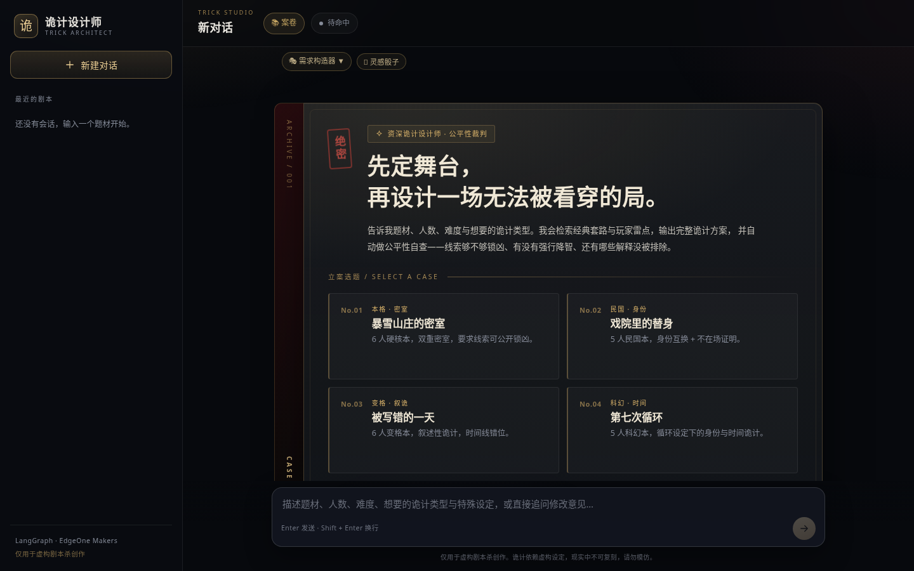
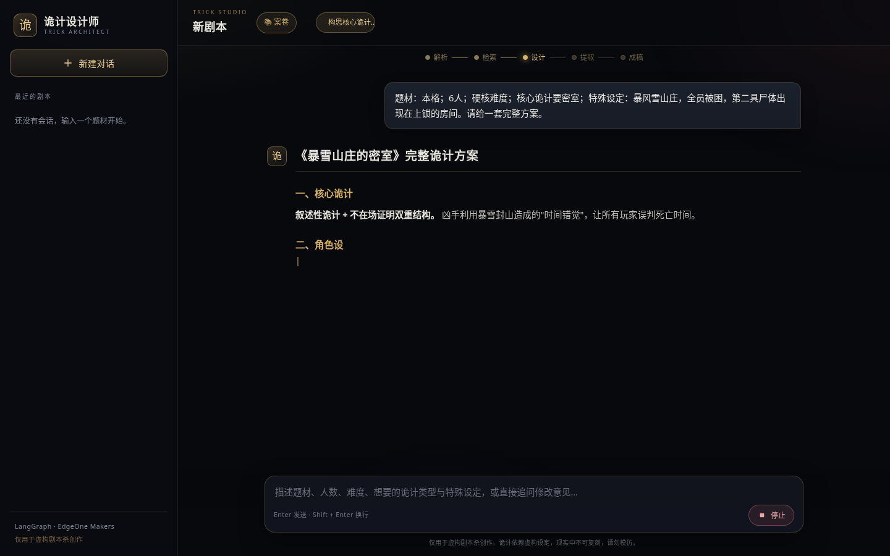
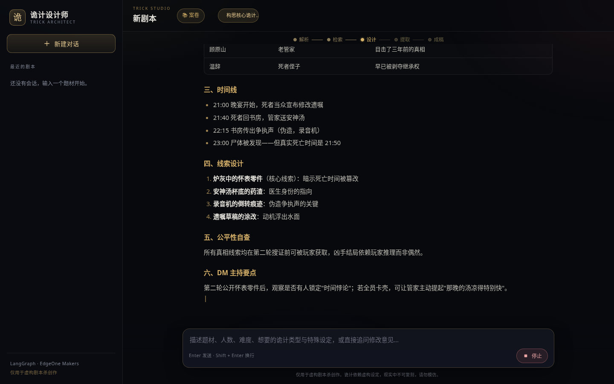
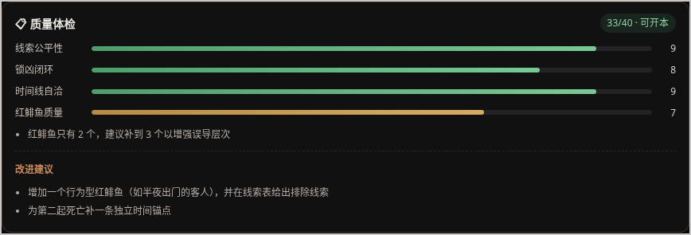
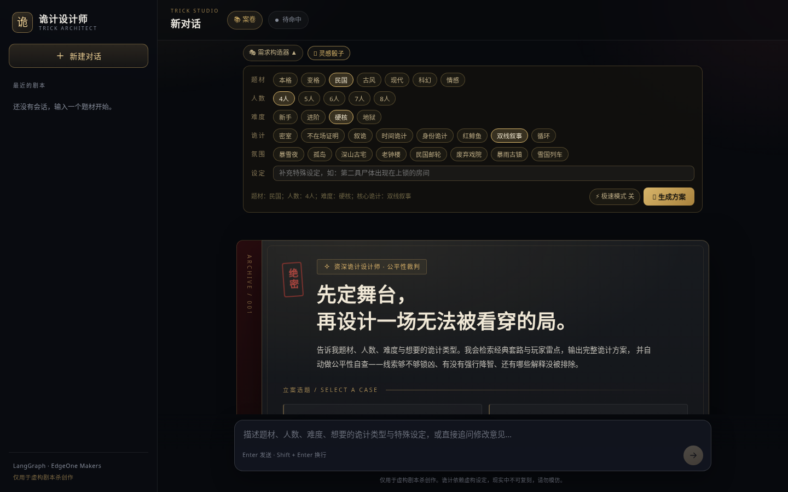
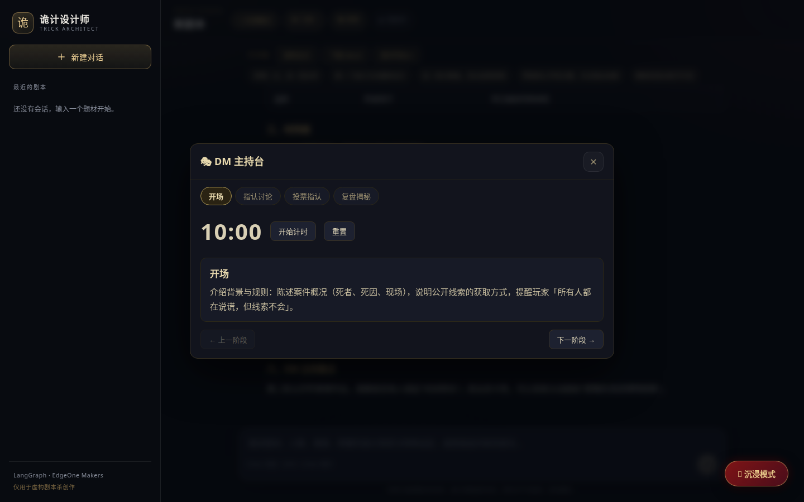
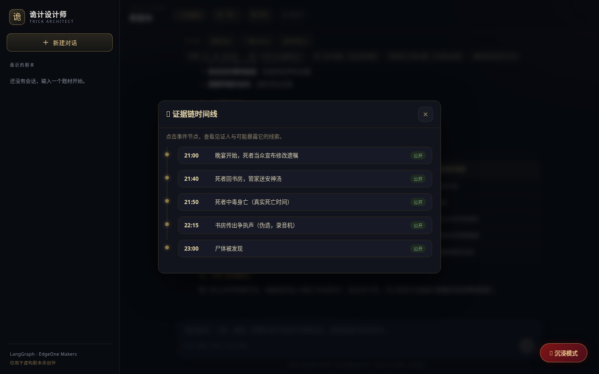
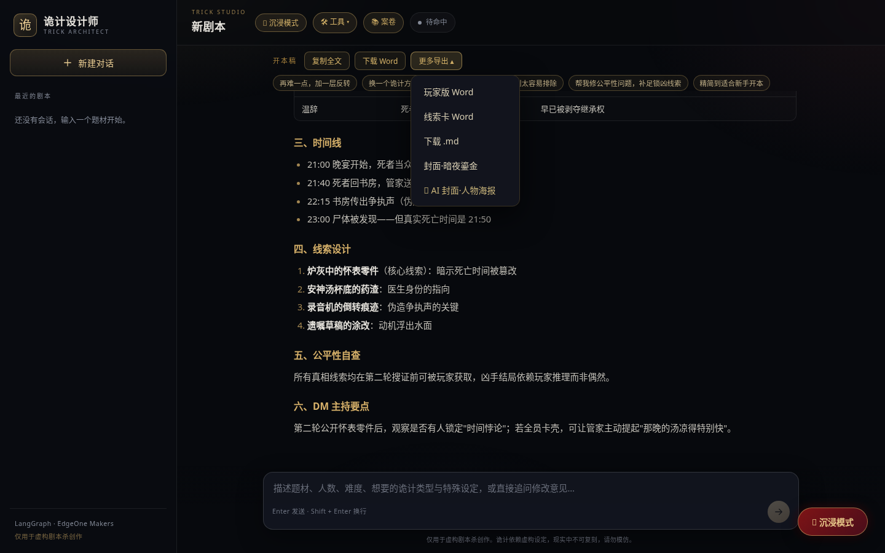
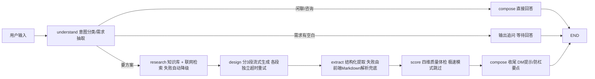

# 诡计设计师 · AI Agent 长文本生成工作台

<p align="center">
  
  
  
  
  
  
  
  
</p>

**一个面向长文本生成场景的 AI Agent 实战项目**：LangGraph 六节点编排、分段流式生成容错、双解析兜底、本地知识库检索、四维质量评分、多模态生图、SSE 心跳与断点续跑。业务载体是剧本杀诡计方案设计，同样的架构可直接迁移到报告生成、课程设计、营销文案等任何长文档生成领域。

<p align="center">
  
  
</p>
<p align="center">
  
  
</p>
<p align="center">
  
</p>

> 一句话需求 → 一份结构完整、可直接使用的长文档方案，外加一整套配套工具链。

## 目录

- [项目解决了什么工程问题](#这个项目解决了什么工程问题)
- [功能一览](#功能一览)
- [技术栈](#技术栈)
- [架构](#架构)
- [关键设计详解](#关键设计详解)
- [使用示例](#使用示例)
- [项目结构](#项目结构)
- [快速开始](#快速开始)
- [接口约定](#接口约定)
- [异常与降级](#异常与降级)
- [测试与质量自检](#测试与质量自检)
- [Roadmap](#roadmap)
- [FAQ](#faq)
- [安全与内容边界](#安全与内容边界)

## 这个项目解决了什么工程问题

| 难题 | 方案 | 结果 |
| --- | --- | --- |
| 长文本生成超过平台函数时长上限，整单超时作废 | **分段流式生成**：方案拆 3 段独立超时/重试（115s/85s/全局 deadline） | 任一段失败只丢一段，已流出内容全部保留 |
| 轻量模型结构化提取不稳定（实测偶发空结果） | **双解析兜底**：后端结构化提取 + 前端从流式 Markdown 现场解析，两者合并 | 提取失败时沉浸模式/线索卡等下游功能依然可用 |
| 长任务被中间层判定空闲掐断连接 | **SSE 心跳**（每 20s）+ 前端识别「正文完整但收尾中断」降级为提示 | 断流不再误报错误，保留断点重试入口 |
| 380KB 的 docx 库拖慢首屏 | **代码分割 + 动态 import** | 首屏 JS 734KB → 351KB（gzip 225KB → 112KB） |
| 多轮对话需要跨实例恢复 | LangGraph Checkpointer 持久化状态机（thread_id = conversation_id） | 无自建数据库即可多轮记忆 + 断点续跑 |
| AI 说「方案很好」但玩家开本才发现推不出来 | **四维 rubric 质量体检**：线索公平性 / 锁凶闭环 / 时间线自洽 / 红鲱鱼质量各 0-10 打分 | 「能不能开本」从主观判断变成可量化的 40 分制指标 |
| 生成内容同质化、套路重复 | **诡计查重 + 双路检索**：从会话 metadata 提取历史诡计指纹（trick_types + core_trick），生成前注入避开指令；关键词加权语料 + 联网检索双路供给 | 同一用户连续生成不会撞车；指纹零额外存储，list_conversations 顺路取回 |

## 功能一览

### 从一句话到完整方案

- **智能追问**：需求有空白时先问 2~3 个带选项的关键问题；说「直接生成」可跳过
- **需求构造器 / 灵感骰子** ：把需求拆成题材 / 人数 / 难度 / 诡计 / 氛围五个维度逐项选择，拼装成一句完整需求；「灵感骰子」一键从各维度候选池随机抽取组合，适合头脑风暴与快速探索
- **多方案对比**：一次给出 A/B/C 三个创意方向，选定后展开完整方案
- **迭代修改**：基于上一版增量调整（换诡计、增删角色、修漏洞），不被旧稿锚定；也支持「补写第 N 部分」恢复降级章节
- **单段重写**：说「重写第二部分」只重跑那一段，其余章节原样保留，不必整篇等 3 分钟

### 质量保障

- **质量体检评分卡**：方案生成后自动按四维 rubric 打分（每维 0-10 分），给出具体到「加一条什么线索」的改进建议；综合 ≥32 且单项 ≥6 判定「可开本」
- **公平性自查**：线索对所有玩家可得，拒绝「只有上帝视角才能破案」的诡计；锁凶证据链要求 2 条独立公开线索 + 1 条深入线索
- **知识库注入**：9 篇原创诡计方法论（密室破法 / 不在场证明构造 / 叙诡公平边界 / 红鲱鱼设计 / 玩家雷点 20 条等）按需求关键词加权检索注入生成上下文

### 开本工具链

<p align="center">
  
  
</p>

- **DM 主持台**：开本各阶段标签（开场 / 搜证 / 讨论 / 指凶）、计时器、开场引导词
- **证据链时间线**：时间线解析为可交互时间轴，点击事件自动匹配「谁作证、哪条线索能戳穿它」
- **角色速览卡**：每个角色的公开身份 / 隐藏身份 / 秘密动机一页速查
- **救场手册**：玩家卡壳时的分级提示话术（轻提示 → 中提示 → 直接揭秘）

### 多模态与导出

<p align="center">
  
</p>

- **AI 封面**：人物海报 / 群像 / 场景三种风格；人脸用 wan2.5-t2i-preview（稳定性优先），场景用 wanx2.1-t2i-turbo（速度优先），按用途分流
- **沉浸互动剧情**：第二人称冒险，限时抉择 + 死亡/存疑/安全结局 + Web Audio 心跳/死亡音效（零音频文件，实时合成）
- **多格式导出**：完整版/玩家版 Word、扑克式线索卡、Markdown、PNG/AI 封面，以及**打印 / 另存为 PDF**（A4 排版，一键打印成册）
- **本地书架**：生成完成的方案自动存入 localStorage 书架，多剧本并行管理

## 技术栈

| 层 | 技术 |
| --- | --- |
| 前端 | React 18 + TypeScript + Vite（手写 CSS，无 UI 框架） |
| 后端 | Python 3.11 + LangGraph（六节点状态机编排）+ LangChain（模型调用 / bind_tools 结构化输出） |
| 对话模型 | 阿里云 DashScope / 通义千问（qwen-plus 主力、qwen-flash 轻量） |
| 生图模型 | 通义万相 **wan2.5-t2i-preview**（人物/群像，人脸稳定）与 **wanx2.1-t2i-turbo**（场景，速度优先），按用途分流；异步任务 + 轮询取图 |
| 检索 | 平台内置 web_search + 本地知识库（kb.py 关键词加权） + 高德地图 API（真实天气注入环境细节） |
| 流式传输 | SSE（fetch + ReadableStream 手写解析，支持 POST 与自定义头） |
| 存储 | EdgeOne Makers KV/Blob（LangGraph Checkpointer）+ localStorage |
| 图形与音效 | Canvas/SVG 封面合成；Web Audio 实时合成音效（零音频文件） |

## 架构



| 节点 | 职责 | 容错 |
| --- | --- | --- |
| `understand` | 意图分类（new / iterate / question）+ 需求字段抽取（BriefPatch schema）+ 追问判断 + 对比模式识别 | LLM 意图判断 + **正则兜底**（寒暄整句匹配 / 问句特征 / 「直接生成」短语），模型抖动时体验一致 |
| `research` | 本地知识库关键词加权检索（tags 精确匹配 + 别名归一化，如「暴风雪山庄」→「封闭场景」）+ 联网检索 | 单条 25s 超时，失败仅提示不阻断 |
| `design` | 3 段独立流式生成（核心诡计 / 凶手线索 / 时间线沉浸剧情），三段共享同一份大纲与系统提示词 | 单段超时独立重试（重试自动加「务必精简」），仍失败则占位降级，绝不让整单作废 |
| `extract` | bind_tools 强制 function call，Pydantic 严格校验，从方案提取结构化 JSON | 超时重试 + JSON 解析兜底；失败时前端 parsePlan 从 Markdown 抢救 |
| `score` | 四维 rubric 打分（线索公平性 / 锁凶闭环 / 时间线自洽 / 红鲱鱼质量），结果经 meta 事件送达前端评分卡 | 极速模式跳过；评分失败静默降级，不影响交付 |
| `compose` | 收尾：标题确定、meta 汇总、咨询问答（qa 模式） | 正文已在 design 实时流式展示，此处只做收尾 |

多轮记忆：`context.store.langgraph_checkpointer` 以 conversation_id 持久化全部状态（messages 全量 + brief/design/quality 等字段），跨实例可恢复；喂给模型的上下文按最近 6~8 条裁剪，**存档与上下文窗口分离**——存的是全量，喂的是最近几句。

## 关键设计详解

### 分段流式生成的容错逻辑

```
段1（核心诡计，预算 115s）
  ├─ 开始前检查全局 deadline（195s），剩余 <20s 直接放弃本段
  ├─ 超时 → 已流出的字保留在页面上 → 重试（提示词追加「务必精简」）
  └─ 两次失败 → 占位符「## 待补充：…」+ notice 提示「回复补写 N 即可」
段2 / 段3 同理，互相独立，一段失败不影响其余
```

设计要点：

1. **失败是常态**：每层都有预案，而不是祈祷不超时
2. **降级而不是崩溃**：宁可交付 90% 的方案 + 占位符，也不交付一个报错
3. **已付出的成本不浪费**：流式输出让「失败的那一半」依然呈现在用户眼前
4. **可恢复**：占位符带「补写 N」指令，用户回复后走 iterate 管线，旧方案全文作为底稿注入，模型只补缺失章节——此时是新一轮独立请求，没有 deadline 压力

### 三段为什么不会「割裂」

- **共享大纲**：三段拿到同一份 base_payload（understand + research 的产出），设定级信息（诡计、凶手）天然一致
- **共享文风规范**：同一个 SystemMessage（11 条硬性质量标准），语气详略统一
- **章节边界切分**：每段的起止都卡在完整的章节标题上，拼接痕迹被正常的章节切换掩盖
- **表格化文体**：方案主体是速览表 / 线索表 / 时间线表，对文风不敏感；叙事最重的背景故事完整待在段 1 内

### 双解析兜底

```
正常路径：design 实时流式输出 Markdown → extract 发起 function call → 规整 JSON → 工具视图
兜底路径：function call 失败 → 后端把完整 Markdown 经 SSE meta 推给前端
         → 前端 parsePlan.ts 用「表格行/章节/子章节」原语 + pick() 多候选键名
           （对抗模型表头不确定性）从 Markdown 还原结构化数据 → 工具视图依然可用
```

### SSE 协议

| 事件 | 载荷 | 前端行为 |
| --- | --- | --- |
| `status` | stage + label | 点亮阶段进度条 |
| `token` | delta | 聊天气泡打字机追加 |
| `notice` | message | 黄色提示条（降级说明 / 评分结果） |
| `meta` | title / genre / lock_score / quality / plan | 存结构化数据，供评分卡与工具视图 |
| `done` | — | 解锁输入框 |
| `error` | message | 显示错误 + 允许 retry |

实现细节：因聊天需要 POST 与自定义头，未用 EventSource，而是 fetch + ReadableStream 手写解析——按 `\n\n` 分帧、`\r\n` 归一、残帧缓存拼接、心跳帧丢弃。

### 生图链路

```
前端选风格（character/group/scene）
→ 后端读会话存储里的结构化 brief（题材/时代/标题）填入三套构图模板
  （模板 = 构图主体 + 光影 + 胶片质感 + 标题留白 + 负面提示词）
→ 按用途选模型：有人脸 → wan2.5（稳定）；纯场景 → wanx2.1-turbo（快）
→ DashScope 异步任务：提交 → task_id → 3s 轮询（上限 90s）→ 下载转 base64
```

## 使用示例

```
你：暴雪山庄背景的密室本，5 人，新手难度

AI：（追问）出发前确认 2 件事：
    1. 核心诡计偏好？ A.物理密室 B.心理盲区 C.时间错位
    2. 要不要红鲱鱼误导线？

你：C，要两个红鲱鱼

AI：🔍 正在检索经典诡计与玩家雷点…
    📝 正在搭建核心诡计（1/3）…（文字打字机流出）
    （约 3 分钟后输出完整方案 + 质量体检 33/40 · 可开本）

你：把凶手换成医生，加一条录音机线索
AI：（iterate 意图）基于上一版增量重写，其余章节保持不变
```

## 项目结构

```
.
├── agents/                      # Makers 会话模式 Runtime（文件/目录即路由）
│   ├── _lib/
│   │   ├── app.py               # HTTP 入口：action 路由、SSE、会话 CRUD、导出、AI 封面
│   │   ├── graph.py             # LangGraph 工作流装配（条件边 + checkpointer 注入）
│   │   ├── nodes.py             # understand / research / design / extract / score / compose
│   │   ├── schemas.py           # 结构化输出的 Pydantic Schema（BriefPatch / PlanDigest / QualityScore）
│   │   ├── prompts.py           # 各节点 SystemMessage + 11 条硬性质量标准
│   │   ├── kb.py                # 本地知识库检索（关键词加权 + 别名归一化）
│   │   ├── knowledge/           # 24 篇诡计方法论语料（通用方法论 11 + 分题材/专精 13）
│   │   ├── dedup.py             # 诡计查重：历史指纹收集 + 避开指令生成（纯函数）
│   │   ├── search.py / amap.py  # 联网检索与天气（失败静默降级）
│   │   └── state.py / config.py / models.py / logger.py
│   ├── trick-designer/index.py  # POST /trick-designer
│   └── stop/index.py            # POST /stop
├── src/
│   ├── components/              # 15 个组件：聊天、沉浸模式、DM 主持台、时间线、
│   │                            #   角色卡、救场手册、质量评分卡、需求构造器、导出栏等
│   ├── lib/api.ts               # SSE 解析（consumeStream/handleEvent）、会话 CRUD
│   ├── lib/parsePlan.ts         # Markdown → 结构化方案（前端兜底解析）
│   ├── lib/docxExporters.ts     # Word 导出（按需动态加载，首屏不加载 docx 库）
│   ├── lib/shelf.ts / sound.ts  # 本地书架 / Web Audio 音效
│   └── App.tsx                  # 全局状态编排
├── docs/screenshots/            # README 展示图
├── edgeone.json                 # Makers 项目配置
└── package.json
```

## 快速开始

```bash
# 1. 安装依赖
npm install
python -m venv .venv && source .venv/bin/activate
pip install -r agents/requirements.txt

# 2. 关联 EdgeOne Makers 项目（同步模型 API Key 等环境变量）
npm i -g edgeone
edgeone makers link

# 3. 本地开发
edgeone makers dev       # http://localhost:8088
```

环境变量（由 `edgeone makers link` 同步）：

| 变量 | 说明 |
| --- | --- |
| 模型 API Key / Base URL | DashScope（qwen + 万相共用） |
| `AMAP_KEY`（可选） | 高德地图，用于真实天气注入 |

## 接口约定

所有 `agents/*` 请求须携带请求头 `Makers-Conversation-Id`（6–36 字符）。

| 路由 | 请求体 | 响应 |
| --- | --- | --- |
| `POST /trick-designer` | `{ "action": "chat", "message": "..." }` | SSE：`session / status / notice / meta / token / done / error` |
| `POST /trick-designer` | `{ "action": "retry" }` | 从 checkpoint 断点续跑 |
| `POST /trick-designer` | `{ "action": "sessions" }` / `"history"` / `"delete"` | 会话管理 |
| `POST /trick-designer` | `{ "action": "export" }` | 导出用完整方案（markdown + brief + plan + lock_score） |
| `POST /trick-designer` | `{ "action": "ai_cover", "cover_style": "character" }` | Base64 封面图（`character` / `group` / `scene`） |
| `POST /stop` | `{ "conversationId": "..." }` | 中止当前运行 |

## 异常与降级

- **联网检索失败/超时**：单条 25s 超时，失败仅提示，不阻断生成
- **知识库为空/未命中**：`retrieve_knowledge()` 返回空列表，流程自动降级为「仅依赖模型与联网检索」
- **结构化提取失败**：前端用 Markdown 解析兜底，功能不中断
- **质量体检失败/极速模式**：评分静默跳过，不推评分卡，方案正文不受影响
- **某一段设计超时**：保留已生成内容，标注「待补充」，可让模型补写
- **模型超时/限流/鉴权失败**：统一转中文友好提示，经 SSE `error` 推送
- **收尾断流**：正文完整时降级为提示，保留断点重试入口
- **客户端断开**：监听 `signal` 中止图执行，避免无效 token 消耗

## 测试与质量自检

### 自动化测试

```bash
pnpm test                        # 前端单元测试（vitest，19 个用例）
.venv/bin/python -m pytest tests/ -q   # 后端单元测试（pytest，50 个用例）
pnpm typecheck                   # 全量类型检查
pnpm build                       # 生产构建
```

CI（`.github/workflows/ci.yml`）在每次 push / PR 自动跑：前端类型检查 + 单元测试 + 构建，后端语法检查 + 单元测试。

覆盖重点放在**容错的纯函数**上——输入输出明确、无外部依赖，一旦坏了用户直接看到错误数据：

| 被测对象 | 用例数 | 为什么值得测 |
| --- | --- | --- |
| `parsePlan.ts` 兜底解析 | 12 | 结构化提取失败时，全靠它从 Markdown 抢救数据；表头措辞变化、缺章节、空输入都要稳 |
| 意图兜底正则（寒暄 / 短问句 / 跳过追问） | 约 30 | 模型抖动时的最后一道防线，误判会让「你好」触发一次 3 分钟的生成 |
| 单段重写识别与拼接 | 约 20 | 拼接算法错了会直接丢用户的已有章节 |
| 打印排版 Markdown 渲染 | 7 | 含 HTML 转义断言，防止方案内容注入 |

写测试过程中发现并修复的真实缺陷：

- **凶手信息提取失效**：`mdSubsection(md, '凶手')` 只查三级标题，而实际章节是二级的「## 四、凶手与人物逻辑」，导致工具视图拿不到凶手名。修复为「subsection → 二级章节 → 全文」三级回退
- **线索名称错列**：`pick(['线索'])` 会先命中最左的「线索内容」列，使 name 取到内容。修复为「先精确相等、再模糊包含」两轮匹配
- **「改一下凶手」误判为重写第一段**：正则把量词「一下」当成了序号「一」，用负向断言 `(?![下些点步])` 排除

### 已修复的真实问题（调试案例）

- **React error #310 整页白屏**：ExportBar 的条件 early return 位于 useState 与 useEffect 之间，hasPlan 变化时 hooks 数量不一致导致崩溃。通过非压缩构建定位，修复为 early return 移至全部 hooks 之后
- **mock 流式不结束**：SSE 响应缺 `Connection: close`，HTTP/1.1 keep-alive 导致前端流永真
- **时间线弹窗解析失败**：方案缺「六、时间线」表格章节，前端解析返回空——正是双解析兜底要处理的场景

## Roadmap

- [x] 单元测试：parsePlan、意图正则、单段拼接、打印渲染 + CI
- [x] 单段重写：只重写指定部分，其余章节原样保留（不必整篇重生成）
- [x] 打印 / PDF 导出：A4 排版 + 浏览器打印，另存为 PDF
- [ ] 公平性规则引擎：把 rubric 打分升级为可执行的硬校验（线索出处闭环、不在场证明可戳穿性）
- [x] 诡计查重：历史方案指纹比对（metadata 零额外存储），命中注入避开指令，用户点名同类型时要求差异化
- [ ] 角色立绘：每个角色单独生成，多图一致性（seed 固定）
- [ ] 玩家侧视图：同一份数据的权限化渲染（遮罩凶手/真相）
- [ ] 分享链接：只读 URL 分享 + 批注协作

## FAQ

**Q: 为什么不用 EventSource？**
A: EventSource 只支持 GET 且不能带自定义头，而聊天需要 POST + 会话 ID 头，所以用 fetch + ReadableStream 手写解析。

**Q: 为什么 3 分钟就出结果？会不会牺牲质量？**
A: 平台函数 300 秒硬上限是约束条件，不是目标。分段 + deadline 的设计保证「一定在时限内交付」，质量由知识库注入、11 条硬性质量标准和四维评分兜底。

**Q: checkpointer 存了什么？**
A: 存对话消息与方案状态（按 conversation_id），用于多轮记忆和断点续跑；密钥等敏感信息在平台环境变量中，不进代码仓库。

**Q: 知识库是 RAG 吗？**
A: 是轻量版（RAG-lite）：关键词加权匹配 + tags 别名归一化，不依赖向量库。好处是零外部依赖、检索结果可解释；代价是语义泛化弱于向量检索——语料过百篇后可平滑升级，检索接口不变。

Q: 防同质化靠知识库吗？

A: 不是。知识库负责「写得专业」，防「写得重复」靠诡计查重：历史方案的 trick_types 与核心手法名作为指纹，与当前需求比对，命中则向提示词注入避开与差异化指令。两套机制各管一头。

## 安全与内容边界

- 仅用于虚构剧本杀创作，不生成真实暴力细节，不设计可现实复刻的手法（核心诡计必须附「现实不可复刻说明」）
- 线索对所有玩家可得，拒绝「只有上帝视角才能破案」的诡计
- `agents/_lib/knowledge/` 下的诡计方法论语料为作者原创整理，只收录手法、结构、思路层面的方法论，不收录任何受版权保护的剧本原文

## 免责声明

本项目仅用于剧本杀虚构内容创作与娱乐，不构成任何现实行为指导。
